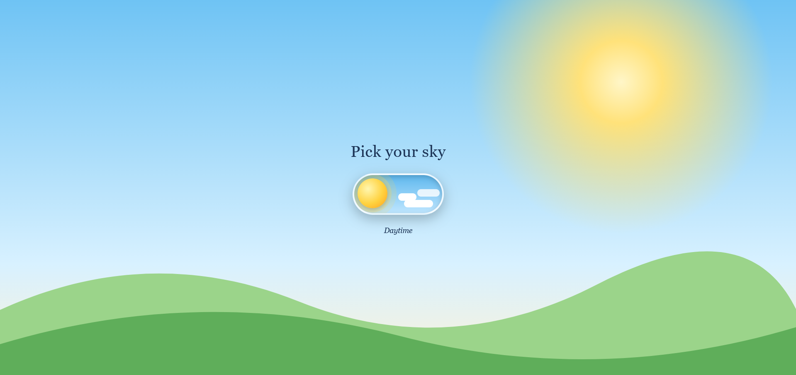
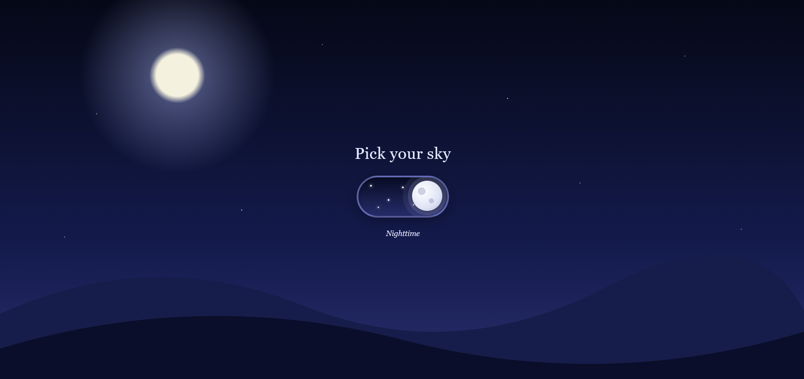

# Pick Your Sky ☀️🌙 — End-to-End Java Spring Boot CI/CD Pipeline


A lightweight **Java Spring Boot** web application with an animated toggle switch that flips the entire page between **daytime** and **nighttime**, automated end-to-end with a **Continuous Integration and Continuous Deployment (CI/CD)** pipeline using **Git, GitHub, Maven, Jenkins, Docker, and Docker Hub**.

---

## 🖥️ Application Preview

| Daytime ☀️ | Nighttime 🌙 |
| :---: | :---: |
|  |  |

### Application Features
- **Animated Toggle Switch:** Smooth transition between sun and moon states (sun ↔ moon).
- **Full-Page Theme Change:** Dynamic sky gradient, sun/moon glow, stars, clouds, and hills.
- **Reactive Mode Labels:** Real-time label updates with the active mode (*Daytime* / *Nighttime*).
- **Lightweight & Cloud-Ready:** Stateless architecture requiring no database, packaged into an executable Spring Boot JAR (`darkmode-1.0.0.jar`) and container image.

---

## 🚀 DevOps CI/CD Architecture

Every code push to GitHub automatically triggers a 6-stage pipeline inside Jenkins running on an Ubuntu Desktop VirtualBox VM.

```text
[Developer (VS Code on Ubuntu Desktop VM)]
       │
       ▼  1. git push
[GitHub Repository: sathyashyam-RSV007/springboot-devops-pipeline]
       │
       ▼  2. Jenkins Poll SCM (* * * * *) detects commit & reads Jenkinsfile
[Jenkins Automation Server (Port 8080)]
       │
       ├──► Stage 1: Compile Code        [CI]  (mvn clean compile)
       ├──► Stage 2: Run Tests           [CI]  (mvn test)
       ├──► Stage 3: Package JAR         [CI]  (mvn package -DskipTests -> darkmode-1.0.0.jar)
       ├──► Stage 4: Build Docker Image  [CI]  (docker build :$BUILD_NUMBER & :latest)
       ├──► Stage 5: Push to Docker Hub  [CD]  (Secure login & push image to Docker Hub)
       └──► Stage 6: Deploy Application  [CD]  (Stop old container & run new container on Port 8081)
              │
              ▼
[Live Containerized Application (http://localhost:8081)]
```

---

## 🔄 CI/CD Pipeline Stages Breakdown

| Stage | Phase Type | Command Executed | Purpose |
| :--- | :--- | :--- | :--- |
| **1. Compile Code** | **Continuous Integration (CI)** | `mvn clean compile` | Removes previous build output and compiles the Java source code. |
| **2. Run Tests** | **Continuous Integration (CI)** | `mvn test` | Runs automated unit tests and stops the pipeline immediately if any test fails. |
| **3. Package JAR** | **Continuous Integration (CI)** | `mvn package -DskipTests` | Packages the compiled code and dependencies into `target/darkmode-1.0.0.jar`. |
| **4. Build Docker Image** | **CI / CD Boundary** | `docker build -t $IMAGE_NAME:$BUILD_NUMBER -t $IMAGE_NAME:latest .` | Packages the Spring Boot JAR and Java 21 JRE into a versioned container image. |
| **5. Push to Docker Hub** | **Continuous Delivery (CD)** | `docker push $IMAGE_NAME:$BUILD_NUMBER` | Authenticates using encrypted Jenkins credentials and pushes images to Docker Hub. |
| **6. Deploy Application** | **Continuous Deployment (CD)** | `docker run -d --name darkmode-container -p 8081:8080 ...` | Replaces the previous container, starts the new container on port `8081`, and prunes old layers. |

---

## 🛠️ Tech Stack & Environment

* **Application:** Java 21, Spring Boot
* **Build Tool:** Apache Maven (`pom.xml`)
* **Source Control:** Git & GitHub
* **CI/CD Automation:** Jenkins LTS (`Jenkinsfile` Pipeline-as-Code with Poll SCM trigger)
* **Containerization:** Docker Engine (`Dockerfile` based on `eclipse-temurin:21-jre`)
* **Container Registry:** Docker Hub (`<your-dockerhub-username>/springboot-darkmode`)
* **Infrastructure:** Ubuntu Desktop VM on Oracle VirtualBox (NAT networking with SSH Port Forwarding)

---

## 📂 Project Structure

```text
springboot-devops-pipeline/
├── docs/
│   └── images/
│       ├── Day.png                  # Daytime mode UI screenshot
│       └── Night.png                # Nighttime mode UI screenshot
├── src/
│   ├── main/                        # Spring Boot Java source & web assets
│   └── test/                        # Automated unit tests
├── Dockerfile                       # Docker image build instructions
├── Jenkinsfile                      # Automated 6-stage CI/CD pipeline definition
├── pom.xml                          # Maven dependencies and build configuration
└── README.md                        # Project documentation
```

---

## 💻 How to Run Locally

### 1. Run with Maven
```bash
git clone [https://github.com/sathyashyam-RSV007/springboot-devops-pipeline.git](https://github.com/sathyashyam-RSV007/springboot-devops-pipeline.git)
cd springboot-devops-pipeline
mvn clean package
java -jar target/darkmode-1.0.0.jar
```
Open `http://localhost:8080` in your browser.

### 2. Run with Docker
```bash
docker pull <your-dockerhub-username>/springboot-darkmode:latest
docker run -d -p 8081:8080 --name darkmode-container <your-dockerhub-username>/springboot-darkmode:latest
```
Open `http://localhost:8081` in your browser.

---

## 👤 Author

**Sathyashyam**
- GitHub: [@sathyashyam-RSV007](https://github.com/sathyashyam-RSV007)