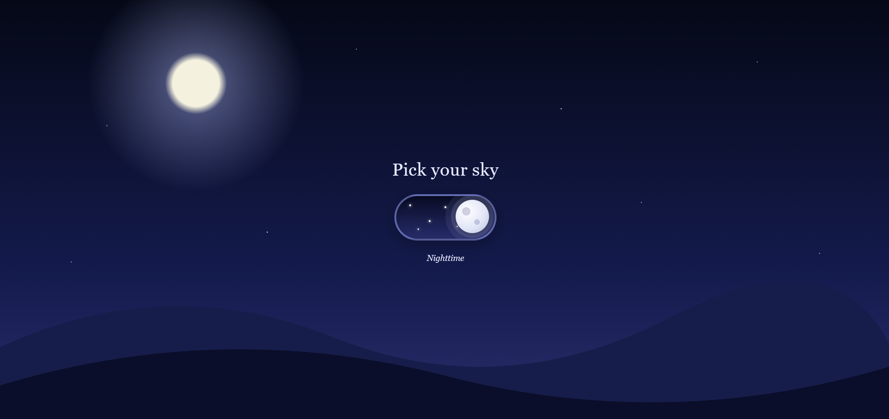

# Pick Your Sky ☀️🌙 — End-to-End Java Spring Boot DevOps Project (V1 & V2)


A lightweight **Java 21 Spring Boot** web application with an animated toggle switch that flips the entire page between **daytime** and **nighttime**. This repository documents the complete, two-version DevOps evolution of the project—starting from an automated **Docker CI/CD pipeline in Version 1** and scaling into **lightweight K3s Kubernetes orchestration and full-stack Observability in Version 2** on bare-metal Ubuntu hardware.

---

## 🖥️ Application Preview

| Daytime ☀️ | Nighttime 🌙 |
| :---: | :---: |
|  |  |

### Application Features
- **Animated Toggle Switch:** Smooth transition between sun and moon states (sun ↔ moon).
- **Full-Page Theme Change:** Dynamic sky gradient, sun/moon glow, stars, clouds, and hills.
- **Reactive Mode Labels:** Real-time label updates with the active mode (*Daytime* / *Nighttime*).
- **Lightweight & Cloud-Ready:** Stateless architecture requiring no database, packaged into an executable Spring Boot JAR (`darkmode-1.0.0.jar`) and container image—instrumented with **Spring Boot Actuator** and **Micrometer** in Version 2.

---

## 📦 Version 1 — Core CI/CD Pipeline (Git, Maven, Jenkins & Docker)

Version 1 established the foundational **Continuous Integration and Continuous Deployment (CI/CD)** loop. Every code push to GitHub automatically triggered a **6-stage Jenkins pipeline** that compiled, tested, packaged, containerized, pushed to Docker Hub, and deployed the standalone Docker container on Ubuntu Desktop.

### Version 1 Architecture

```text
[Developer (VS Code on Ubuntu Desktop)]
       │
       ▼  1. git push
[GitHub Repository: sathyashyam-RSV007/springboot-devops-pipeline]
       │
       ▼  2. Jenkins Poll SCM (* * * * *) detects commit & reads Jenkinsfile
[Jenkins Automation Server (Port 8080)]
       │
       ├──► Stage 1: Compile Code        [CI]  (mvn clean compile)
       ├──► Stage 2: Run Tests           [CI]  (mvn test)
       ├──► Stage 3: Package JAR         [CI]  (mvn package -DskipTests -> darkmode-1.0.0.jar)
       ├──► Stage 4: Build Docker Image  [CI]  (docker build :$BUILD_NUMBER & :latest)
       ├──► Stage 5: Push to Docker Hub  [CD]  (Secure login & push image to Docker Hub)
       └──► Stage 6: Deploy Application  [CD]  (Stop old container & run new container on Port 8081)
              │
              ▼
[Live Standalone Docker Container (http://localhost:8081)]
```

### Version 1 Highlights
- **Pipeline-as-Code (`Jenkinsfile`):** Automated build, test, JAR packaging, Docker image tagging (`:$BUILD_NUMBER` and `:latest`), encrypted Docker Hub authentication (`dockerhub-creds`), and container deployment.
- **Containerization (`Dockerfile`):** Built on `eclipse-temurin:21-jre`, exposing Spring Boot on internal port `8080` and mapping it to host port `8081` (`darkmode-container`).
- **Why We Evolved to Version 2:** Running a standalone Docker container via `docker rm -f` and `docker run` introduced brief downtime on every release, lacked automatic self-healing or post-deploy health verification, and provided no historical metrics or centralized log retention once a container was replaced.

---

## 🚀 Version 2 — Lightweight K3s Orchestration & Full-Stack Observability

Version 2 migrated the environment from a VirtualBox VM onto **bare-metal Ubuntu hardware** (`~1.5 GiB` usable DDR3 RAM, `8.0 GiB` swap), replaced raw Docker container execution with **K3s Kubernetes**, and integrated a native **Prometheus + Grafana Alloy + Loki + Grafana** observability stack.

### Evolution Summary: Version 1 → Version 2

| Capability | Version 1 (Core CI/CD) | Version 2 (K3s & Observability) |
| :--- | :--- | :--- |
| **Host Infrastructure** | VirtualBox Ubuntu VM | Bare-Metal Ubuntu (`~1.5 GiB` usable RAM, `8.0 GiB` swap) |
| **Runtime & Orchestration** | Standalone Docker container (`darkmode-container` on `:8081`) | Lightweight **K3s Kubernetes** Pod exposed via NodePort `:30081` |
| **Deployment Strategy** | Stop & recreate (`docker rm -f` + `docker run`) with downtime | Automated **K3s Rolling Updates** using immutable `:$BUILD_NUMBER` tags |
| **Health Verification** | None (build passed even if app failed after startup) | **Spring Boot Actuator** (`/actuator/health`), K8s Startup/Readiness/Liveness probes & Jenkins retry gate |
| **Metrics Monitoring** | None | **Micrometer** + **Prometheus** scraping `/actuator/prometheus` every `5s` |
| **Centralized Logging** | Local `docker logs` only | **Grafana Alloy** (K8s API discovery) → **Grafana Loki** |
| **Dashboards** | None | Unified **Grafana** dashboard (Golden Signals, JVM saturation & live Pod logs) versioned in Git |

### Version 2 End-to-End Architecture

```text
[Developer (VS Code)] ──► git push ──► [GitHub: sathyashyam-RSV007/springboot-devops-pipeline]
                                                         │
                                                         ▼  Poll SCM (* * * * *)
                                             [Jenkins Server (Port 8080)]
                                                         │
        ┌────────────────────────────────────────────────┴────────────────────────────────────────────────┐
        ▼                                                                                                 ▼
[Continuous Integration (CI)]                                                              [Continuous Deployment (CD)]
├── Stage 1: Compile Code       (mvn clean compile)                                        ├── Stage 5: Push to Docker Hub (+ local prune)
├── Stage 2: Run Tests          (mvn test)                                                 ├── Stage 6: Deploy to K3s (kubectl apply :$BUILD_NUMBER)
├── Stage 3: Package JAR        (mvn package -DskipTests -> darkmode-1.0.0.jar)            └── Stage 7: Verify Rollout & /actuator/health (retry gate)
└── Stage 4: Build Docker Image (docker build :$BUILD_NUMBER & :latest)                                   │
                                                                                                          ▼
                                             [K3s Lightweight Kubernetes (API :6443)]
                                             ┌────────────────────────────────────────────────────────┐
                                             │  Service: pick-your-sky-svc (NodePort :30081 -> :8080) │
                                             │  Pod:     pick-your-sky (Spring Boot, -Xmx256m)        │
                                             │  Probes:  Startup | Readiness | Liveness (/actuator)   │
                                             └──────────────┬──────────────────────────┬──────────────┘
                                                            │ /actuator/prometheus     │ K3s API Pod Log Stream
                                                            ▼ (5s scrape)              ▼ (K8s Pod Discovery)
                                                 [Prometheus (:9090)]         [Grafana Alloy (:12345)]
                                                            │                          │ HTTP Push
                                                            │                          ▼
                                                            │                  [Grafana Loki (:3100)]
                                                            │                          │
                                                            └────────────► ◄───────────┘
                                                                 [Grafana UI (:3000)]
                                                  (Four Golden Signals + JVM Health + Live Pod Logs)
```

### Upgraded 7-Stage Pipeline (`Jenkinsfile`)
Running with an explicit `KUBECONFIG = "/var/lib/jenkins/.kube/config"` environment variable:
1. **Compile Code:** `mvn clean compile`
2. **Run Tests:** `mvn test`
3. **Package JAR:** `mvn package -DskipTests` (bundles Spring Boot Actuator & Micrometer into `darkmode-1.0.0.jar`)
4. **Build Docker Image:** `docker build -t $IMAGE_NAME:$BUILD_NUMBER -t $IMAGE_NAME:latest .`
5. **Push to Docker Hub & Clean Cache:** Logs in via `--password-stdin`, pushes both tags, logs out, and cleans up local Docker cache (`docker rmi` + `docker image prune -f`) since K3s pulls images directly via `containerd`.
6. **Deploy to K3s:** Applies `k8s/service.yaml` and dynamically injects `:$BUILD_NUMBER` into `k8s/deployment.yaml` via `sed "s|:latest|:${BUILD_NUMBER}|g" k8s/deployment.yaml | kubectl apply -f -` without modifying Git—forcing a true versioned rolling update while preserving rollback history (`kubectl rollout undo`).
7. **Verify K3s Rollout & Health:** Waits for `kubectl rollout status deployment/pick-your-sky --timeout=180s`, followed by a 6-attempt `curl` retry loop against `http://localhost:30081/actuator/health` confirming `"status":"UP"`.

### Lightweight K3s Orchestration & Bare-Metal Optimizations
Engineered to run the entire CI/CD, Kubernetes, and Observability stack cleanly within `~1.5 GiB` of usable RAM:
- **Minimal Control Plane (`/etc/rancher/k3s/config.yaml`):** Disabled `traefik`, `servicelb`, `metrics-server`, `local-storage`, and `disable-helm-controller: true`, leaving only `coredns` in `kube-system` and holding K3s to **~327 MiB active RAM**.
- **Bounded JVM & Container Governance (`k8s/deployment.yaml`):** Sets `JAVA_TOOL_OPTIONS="-Xmx256m"`, memory requests (`192Mi`) / limits (`384Mi`), and CPU requests (`100m`) / limits (`500m`).
- **Self-Healing Kubernetes Probes (`/actuator/health` on Port `8080`):**
  - **Startup Probe:** `periodSeconds: 5`, `failureThreshold: 24` (120s window for cold JVM boot).
  - **Readiness Probe:** `periodSeconds: 10`, `failureThreshold: 3` (gates Service traffic until ready).
  - **Liveness Probe:** `periodSeconds: 15`, `failureThreshold: 3` (auto-restarts frozen containers).
- **NodePort Service (`k8s/service.yaml`):** Exposes host port **`30081`** (within Kubernetes's `30000–32767` NodePort range, avoiding collision with Jenkins on `8080`) mapped to container port **`8080`**.

### Full-Stack Observability Pipeline
- **Application Instrumentation (Actuator & Micrometer):** Configured in `src/main/resources/application.properties` to expose `/actuator/health` (with `show-details=always`) and `/actuator/prometheus` tagged with `application=pick-your-sky`.
- **Metrics Collection (Prometheus — Port `9090`):** Scrapes `http://localhost:30081/actuator/prometheus` every `5s` under `job_name: 'pick-your-sky'`.
- **Log Shipping (Grafana Alloy → Loki):** Replaced legacy Promtail with **Grafana Alloy** (`:12345`). Uses `discovery.kubernetes` and `loki.source.kubernetes` with a dedicated kubeconfig (`/etc/alloy/k3s.yaml`) to discover `pick-your-sky` Pods directly via the K3s API, extract `namespace`, `pod`, `container`, and `app` labels, and push logs to **Grafana Loki** (`:3100`) seamlessly across rolling updates.
- **Unified Dashboard (`monitoring/grafana-dashboard.json`):** Version-controlled in Git as **Observability as Code**, featuring a dynamic `$pod` variable and three rows:
  - **Row 1 — Availability & Golden Signals:** Live `UP`/`DOWN` status (`Instant` query), Pod Uptime, Real User Request Rate (`uri!~"/actuator.*"`), HTTP `4xx`/`5xx` Error Rate, and Average Response Latency.
  - **Row 2 — JVM & Container Saturation:** JVM Heap Used vs. `-Xmx256m` Cap, Process CPU Usage, and Live vs. Daemon Threads.
  - **Row 3 — Centralized K3s Pod Logs:** Log Volume & Error/Warning Spike Rate alongside a live, expandable K3s Pod log stream.

---

## 🔌 Ports & Endpoints Reference

| Service / Component | Port | Version | Access / Purpose |
| :--- | :---: | :---: | :--- |
| **Jenkins Server** | `8080` | V1 & V2 | CI/CD automation web UI (`http://localhost:8080`) |
| **Spring Boot (Inside Container/Pod)** | `8080` | V1 & V2 | Internal embedded Tomcat server (`/`, `/actuator/health`, `/actuator/prometheus`) |
| **Docker Standalone App (Retired)** | `8081` | V1 | Legacy V1 host port mapped to container `8080` |
| **Pick Your Sky (K3s NodePort)** | `30081` | V2 | Production K3s access point & Prometheus scrape target (`http://localhost:30081`) |
| **K3s Kubernetes API** | `6443` | V2 | Control plane API used by `kubectl`, Jenkins, and Grafana Alloy |
| **Prometheus** | `9090` | V2 | Time-series metrics server & PromQL UI (`http://localhost:9090`) |
| **Grafana Alloy** | `12345` | V2 | Telemetry collector & live pipeline debugger (`http://localhost:12345`) |
| **Grafana Loki** | `3100` | V2 | Log aggregation engine (`/loki/api/v1/push`, `/ready`) |
| **Grafana UI** | `3000` | V2 | Unified metrics & logs visualization UI (`http://localhost:3000`) |

---

## 🛠️ Complete Tech Stack (V1 + V2)

* **Application:** Java 21, Spring Boot `3.3.4`, Spring Boot Actuator, Micrometer
* **Build Tool:** Apache Maven (`pom.xml`)
* **Source Control:** Git & GitHub
* **CI/CD Automation:** Jenkins LTS (`Jenkinsfile` Pipeline-as-Code with Poll SCM)
* **Containerization & Registry:** Docker Engine (`eclipse-temurin:21-jre`), Docker Hub (`sathyahub123/springboot-darkmode`)
* **Container Orchestration:** K3s Lightweight Kubernetes (`containerd`, declarative YAML manifests)
* **Observability Stack:** Prometheus, Grafana Alloy, Grafana Loki, Grafana
* **Operating System:** Ubuntu Desktop (VirtualBox VM in V1 → Bare-Metal in V2)

---

## 📂 Project Structure

```text
springboot-devops-pipeline/
├── docs/
│   └── images/
│       ├── Day.png                      # Daytime mode UI screenshot
│       └── Night.png                    # Nighttime mode UI screenshot
├── k8s/                                 # [V2] Kubernetes manifests
│   ├── deployment.yaml                  # K3s Deployment (JVM cap, limits, Startup/Readiness/Liveness probes)
│   └── service.yaml                     # K3s NodePort Service exposing port 30081 -> 8080
├── monitoring/                          # [V2] Observability as Code
│   └── grafana-dashboard.json           # Exported unified Prometheus & Loki Grafana dashboard
├── src/
│   ├── main/
│   │   ├── java/                        # Spring Boot Java source code
│   │   └── resources/
│   │       └── application.properties   # [V2] Actuator & Micrometer Prometheus configuration
│   └── test/                            # Automated unit tests
├── Dockerfile                           # Docker image build instructions (eclipse-temurin:21-jre)
├── Jenkinsfile                          # 7-stage CI/CD pipeline (evolved from V1 6-stage Docker to V2 K3s)
├── pom.xml                              # Maven dependencies (Spring Web, Actuator, Micrometer)
└── README.md                            # Project documentation (V1 & V2)
```

---

## 💻 How to Run Locally or Deploy

### 1. Run Locally with Maven
```bash
git clone https://github.com/sathyashyam-RSV007/springboot-devops-pipeline.git
cd springboot-devops-pipeline
mvn clean package
java -jar target/darkmode-1.0.0.jar
```
Open `http://localhost:8080` in your browser (Actuator endpoints available at `/actuator/health` and `/actuator/prometheus`).

### 2. Run with Docker (Version 1 Standalone Mode)
```bash
docker pull sathyahub123/springboot-darkmode:latest
docker run -d -p 8081:8080 --name darkmode-container sathyahub123/springboot-darkmode:latest
```
Open `http://localhost:8081` in your browser.

### 3. Deploy to K3s / Kubernetes (Version 2 Orchestrated Mode)
```bash
kubectl apply -f k8s/
kubectl rollout status deployment/pick-your-sky
kubectl get pods,svc
```
Verify the exposed endpoints:
```bash
curl -s http://localhost:30081/actuator/health
curl -s http://localhost:30081/actuator/prometheus | head -n 10
```
Open `http://localhost:30081` in your browser.

---

## 👤 Author

**Sathyashyam**
- GitHub: [@sathyashyam-RSV007](https://github.com/sathyashyam-RSV007)
- Docker Hub: [sathyahub123/springboot-darkmode](https://hub.docker.com/r/sathyahub123/springboot-darkmode)

